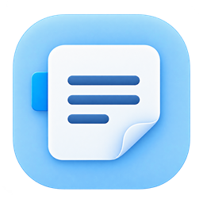

# progress-notes

# 进步签

面向 Windows 的个人桌面便签：把月历、重要任务倒计时与分类记录放在同一张面板上。



## 功能

- 嵌入 Explorer 桌面层，包含周一开头的月历、农历和一个共用倒计时。
- 分类便签；双击进入编辑，停止输入约一秒后静默保存。
- 拼音组字期间延后保存，编辑窗口失去焦点时不自动关闭。
- 浅蓝界面、整体背景透明度调节、顶部折叠和可锁定的位置。
- 中文为微软雅黑 UI，英文和数字为 Times New Roman。
- 个人中心包含透明度、位置、数据目录和开机启动开关。开机启动默认关闭。
- 固定本机数据目录、原子写入、每日备份、升级前备份及并发写入保护。

## 环境与构建

项目使用 C#、Windows Forms 和 Win32 API，当前构建目标为 Windows x64 / .NET Framework。
建议在装有 .NET Framework 4.8 的 Windows 10/11 x64 上构建与使用；目前未完成完整系统兼容矩阵验证。
编译脚本使用 Windows Framework64 目录中的 C# 编译器，不需要 NuGet 包。

在仓库目录运行：

```powershell
.\build.ps1
.\test.ps1
```

程序输出到 `bin/进步签.exe`。若本机脚本策略阻止执行，可在当前进程中允许已检查的脚本，或使用可信的构建环境。
请勿将测试报告、二进制产物和个人数据提交到仓库。

## 使用

1. 运行 `进步签.exe`；已有便签运行时先从右键菜单退出。
2. 双击正文编辑；输入会自动保存，“完成”按钮只用于结束编辑。
3. 双击倒计时设置任务与目标日期。
4. 左侧标签切换分类，“＋”新增分类；右键标签可重命名。
5. 左上角头像进入个人中心。解锁位置后拖动主面板顶部文字移动。

## 数据与升级

本机数据位于 `%LOCALAPPDATA%\DesktopNote\data`。目录名出于历史兼容保留，与软件显示名称无关。
正文、倒计时与本机设置在同一 JSON 文件的独立区段中原子提交。
正常升级沿用固定目录；首次使用建立新记录，不扫描旁边的历史版本。
历史数据仅在明确指定目录时导入：

```powershell
& '.\bin\进步签.exe' --import-data 'D:\your-backup\data'
```

此命令只允许在本机尚无 workspace 数据时执行，已有数据时拒绝覆盖。
支持工作区格式 1/2 的 `workspace.json` 或其备份；更早的原型格式不保证支持。
导入前会归档所选目录的工作区文件，原文件不改写。
备份在数据目录的 `backups` 中，暂不自动清理；本机备份不能替代异地备份。
遇到未知的更新数据格式会停止读写，不以旧备份覆盖它。

开机启动在当前用户的 Windows Run 注册表项下维护进步签自己的条目。
开启后保存完整程序路径，升级启动时更新已有条目；关闭不影响其他程序。
移动程序后请重新设置开关；任务管理器或系统策略也可能影响启动。

## 当前限制

- 尚无云同步、微信登录、手机编辑、自动更新或图形化备份恢复。
- 依赖 Explorer 桌面视图，不支持 macOS/Linux。
- 实际拼音候选框、登录后自启动、休眠唤醒及多显示器缩放需要进一步实机验证。
- 未做代码签名；这不是已经完成全面兼容测试的商业发布版。

## 目录

- `src/`：程序源码与清单。
- `assets/`：图标与原始设计素材。
- `build.ps1`、`test.ps1`：构建和隔离测试。
- `docs/`：架构、测试范围和贡献说明。

## 开源与素材

采用 [MIT License](LICENSE)，Copyright © 2026 TobeAristotle。
本项目由作者与 AI 辅助协作开发，图标为 AI 辅助生成素材。
仓库不包含 Windows 字体文件、系统 DLL、个人笔记或登录凭据。
提交问题时请使用虚构笔记复现，避免上传个人记录和数据备份。
